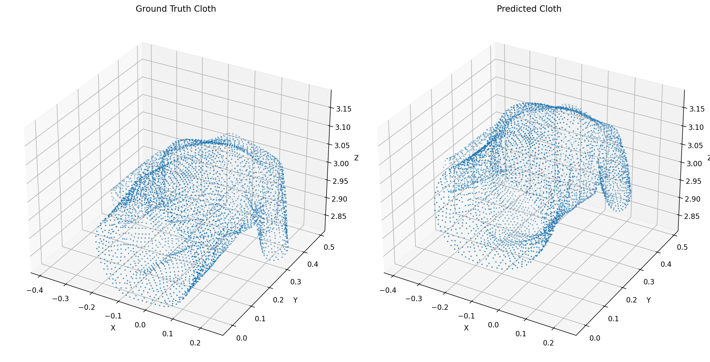
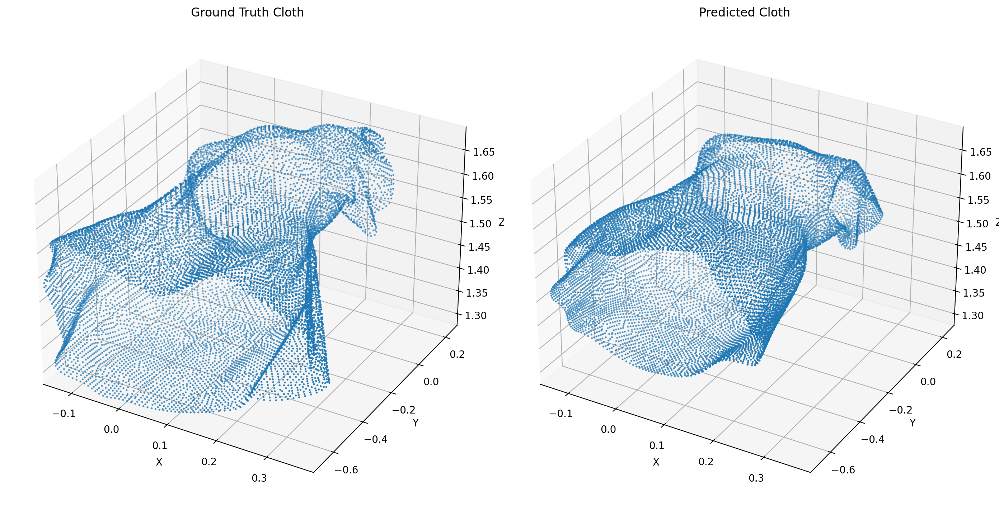
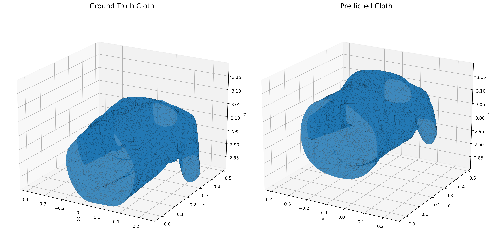
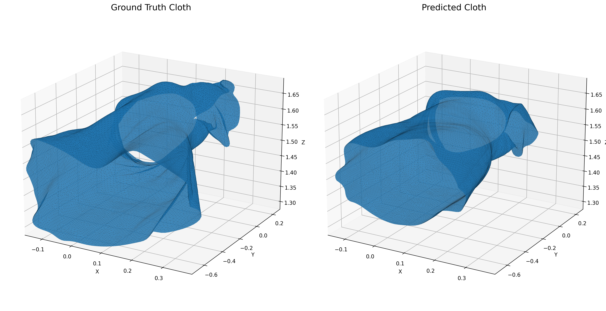

# Data-Driven Cloth for Interactive Applications

A neural-network-based approach for predicting 3D garment geometry from human pose parameters.

This project is inspired by the paper:

> **Data-Driven Clothing for Interactive Applications**  
> Kangrui Xue and Jane Wu  
> Stanford CS229 Project

The objective is to replace expensive cloth simulation with a learned model that can rapidly predict garment geometry from a given human pose.

---

## 1. Problem Statement

Physics-based cloth simulation can produce realistic garment deformation, but it can be computationally expensive for interactive applications.

This project investigates a data-driven alternative:

```text
Human Pose
    ↓
Neural Network
    ↓
PCA Garment Representation
    ↓
3D Cloth Geometry
```

Instead of running a physics simulation for every new pose, the trained neural network predicts the garment configuration directly.

---

## 2. Project Objective

The main objectives are:

- Learn the relationship between human pose and simulated garment geometry.
- Reduce the dimensionality of the high-dimensional garment representation using PCA.
- Train a fully connected neural network to predict PCA garment coefficients.
- Use ReLU activation functions.
- Train the network using the Adam optimizer.
- Reconstruct the predicted 3D garment from the PCA representation.
- Evaluate prediction accuracy against simulated ground-truth garments.
- Measure inference speed for interactive applications.
- Provide an interactive visualization of predicted cloth across test poses.

---

## 3. Reference Approach

The project is based on the general data-driven clothing pipeline presented in:

**Data-Driven Clothing for Interactive Applications**

The reference approach uses:

1. Large-scale cloth simulation to generate training data.
2. Pose parameters as input.
3. Dimensionality reduction of garment geometry using PCA.
4. A fully connected neural network to predict the reduced garment representation.
5. Reconstruction of garment geometry from the predicted representation.

Our implementation follows this general data-driven approach while adapting it to the available Santesteban simulated garment dataset.

---

## 4. Dataset

This project supports the T-shirt and Dress subsets of the Santesteban virtual try-on dataset. Each subset contains simulated garment sequences with pose parameters, vertices, triangular faces, and simulation metadata.

The raw dataset is approximately 11 GB and stays outside this repository. The pipeline reads up to 100 sorted `.pkl` simulation files from each garment's `simulations` directory. Mesh vertex and face counts are read from those files; they are not shared constants. The current processed datasets use 4,424 vertices and 8,710 faces for T-shirt, and 12,146 vertices and 23,949 faces for Dress.

The existing T-shirt processed arrays, checkpoint, and results are retained under the lowercase `tshirt/` artifact folders. Dress artifacts are isolated under `dress/`.

### Dataset Source

The dataset and associated project materials are provided by Santesteban et al. through their virtual try-on research project and repository.

- Project repository:  
  https://github.com/isantesteban/vto-garment-collisions

- Dataset repository:  
  https://github.com/isantesteban/vto-dataset

---

## 5. Input Representation

The available dataset provides a 72-dimensional pose representation.

Therefore:

```text
Input dimension = 72
```

Each input corresponds to one simulated garment frame.

The reference Stanford project uses joint rotation quaternions as its pose representation. This implementation uses the native 72-dimensional pose representation provided by the Santesteban dataset instead.

This is an implementation adaptation rather than an exact reproduction of the original paper's input representation.

---

## 6. Output Representation

Each garment is represented by three coordinates `(x, y, z)` per vertex. The resulting coordinate dimension is derived from that garment's vertex array; the existing T-shirt representation has 13,272 coordinates. Directly predicting all coordinates would result in a high-dimensional output space.

To reduce this dimensionality, PCA is applied to the garment geometry.

---

## 7. PCA Dimensionality Reduction

PCA is fitted only on the training data to avoid test-data leakage.

The garment representation is reduced to:

```text
64 PCA components
```

For the current processed datasets, the 64 components retain 99.99831% of T-shirt variance and 99.99642% of Dress variance. PCA is fitted independently for each garment during preparation.

The neural network therefore predicts 64 values instead of 13,272 T-shirt coordinates or 36,438 Dress coordinates.

The predicted 64-dimensional representation is then transformed back into the original garment space using the inverse PCA transformation.

---

## 8. Dataset Split

The selected 100 files per garment were divided into these frame-level splits:

| Garment | Total frames | Training | Validation | Testing |
|---|---:|---:|---:|---:|
| T-shirt | 12,290 | 8,603 | 1,843 | 1,844 |
| Dress | 12,645 | 8,851 | 1,897 | 1,897 |

The current implementation uses a frame-level random split.

---

## 9. Neural Network Architecture

A fully connected feed-forward neural network is used.

```text
Input
72 pose parameters
      │
      ▼
Linear Layer
72 → 128
      │
      ▼
ReLU
      │
      ▼
Linear Layer
128 → 256
      │
      ▼
ReLU
      │
      ▼
Linear Layer
256 → 128
      │
      ▼
ReLU
      │
      ▼
Linear Layer
128 → 64
      │
      ▼
PCA garment representation
```

### Architecture

```text
Input:       72
Hidden 1:    128 + ReLU
Hidden 2:    256 + ReLU
Hidden 3:    128 + ReLU
Output:      64
```

---

## 10. Training

The model is trained using:

- **Framework:** PyTorch
- **Loss function:** Mean Squared Error (MSE)
- **Optimizer:** Adam
- **Learning rate:** 0.001
- **Batch size:** 32
- **Epochs:** 100

Training automatically uses CUDA when available and otherwise falls back to CPU.

---

## 11. Training Results

The current saved histories contain per-epoch values for all 100 epochs:

| Garment | Final Training Loss | Final Validation Loss |
|---|---:|---:|
| T-shirt | 1.219721 | 1.199557 |
| Dress | 3.060994 | 5.229857 |

Full histories are saved in `results/<garment>/training_history.csv`.

---

## 12. Evaluation

After predicting the 64 PCA coefficients, the evaluator applies the garment-specific inverse PCA transform and reshapes the result into 3D vertices. `validate.py` evaluates the validation split and writes `validation_*` artifacts; `test.py` evaluates the held-out test split and writes the standard prediction files. Metrics are saved separately in `validation_metrics.txt` and `evaluation_metrics.txt` under each garment's results directory.

Current saved metrics are:

| Garment | Split | Coordinate MSE | Coordinate RMSE | Mean Vertex Error | Maximum Vertex Error |
|---|---|---:|---:|---:|---:|
| T-shirt | Validation | 0.00668294 | 0.08174925 | 0.09972924 | 1.06472671 |
| T-shirt | Test | 0.00783738 | 0.08852900 | 0.10137938 | 1.31943631 |
| Dress | Validation | 0.01471933 | 0.12132326 | 0.14150962 | 1.73471749 |
| Dress | Test | 0.01583993 | 0.12585677 | 0.14734755 | 1.50103354 |

---

## 13. Inference Performance

The current saved benchmarks were measured on CPU:

| Garment | Neural Network (ms) | PCA Reconstruction (ms) | Total (ms) | Estimated FPS |
|---|---:|---:|---:|---:|
| T-shirt | 0.5324 | 0.2598 | 0.7922 | 1,262.33 |
| Dress | 0.3437 | 0.4530 | 0.7968 | 1,255.08 |

> **Note:** This benchmark measures neural-network inference and PCA reconstruction only. It does not represent the complete GUI or 3D rendering frame rate.

---

## 14. Interactive Demo

An interactive visualization is provided using the test poses.

The user can move through the test frames using a slider.

For each pose, the system displays:

```text
Ground Truth Cloth
        vs.
Neural Network Prediction
```

The corresponding MSE, RMSE, and mean vertex error are also displayed.

Run:

```bash
python src/pipeline/interactive_demo.py
```

The command processes all configured garments. Close each garment window to continue to the next one; use `--garment tshirt` or `--garment dress` to select only one.

---

## 15. Visualization

### Point-Cloud Comparison

Run:

```bash
python src/pipeline/visualize.py
```

Generates one image per configured garment:

```text
results/<garment>/cloth_comparison.png
```

Example outputs:

| T-shirt | Dress |
|---|---|
|  |  |

### Surface Mesh Comparison

Run:

```bash
python src/pipeline/visualize_mesh.py
```

Generates one image per configured garment:

```text
results/<garment>/cloth_surface_comparison.png
```

| T-shirt surface | Dress surface |
|---|---|
|  |  |

Surface visualization uses the selected garment's triangular mesh topology.

### Training Curve

Run:

```bash
python src/pipeline/plot_training.py
```

Generates one image per configured garment:

```text
results/<garment>/training_validation_loss.png
```

---

## 16. Inference Pipeline

The complete pipeline is:

```text
                         Human Pose
                               │
                               ▼
                  72-dimensional input
                     │
                     ▼
            Fully Connected NN
                     │
              ReLU activations
                     │
                     ▼
             64 PCA coefficients
                     │
                     ▼
                PCA inverse
                     │
                     ▼
       garment vertex count × 3 coordinates
                     │
                     ▼
                   garment-specific vertices
                     │
                     ▼
                selected garment mesh
```

---

## 17. Repository Structure

```text
Data-Driven-Cloth-For-Interactive-Applications/
│
├── data/
│   └── processed/
│       ├── tshirt/ (retained arrays, PCA, faces, metadata)
│       └── dress/  (prepared arrays, PCA, faces, metadata)
│
├── models/
│   ├── tshirt/cloth_predictor.pth
│   └── dress/cloth_predictor.pth
│
├── images/
│   ├── tshirt_comparison.png
│   ├── tshirt_surface_comparison.png
│   ├── dress_comparison.png
│   └── dress_surface_comparison.png
│
├── results/
│   ├── tshirt/ (training, validation, test, benchmark, and visualization outputs)
│   └── dress/  (training, validation, test, benchmark, and visualization outputs)
│
├── src/pipeline/
│   ├── garment_config.py
│   ├── model.py
│   ├── prepare_dataset.py
│   ├── train.py
│   ├── validate.py
│   ├── test.py
│   ├── evaluation_runner.py
│   ├── visualize.py
│   ├── visualize_mesh.py
│   ├── interactive_demo.py
│   ├── benchmark.py
│   └── plot_training.py
│
├── .gitignore
└── README.md
```

---

## 18. Installation

Create a Python environment if required.

Install the required packages:

```bash
pip install numpy
pip install scikit-learn
pip install joblib
pip install torch
pip install matplotlib
```

---

## 19. Running the Project

Set the external dataset root once in PowerShell (it contains `tshirt/` and `dress/`):

```powershell
$env:CLOTH_DATASET_ROOT = "D:\datasets\vto-dataset-main"
```

Alternatively, pass `--dataset-dir` with one garment's `simulations` folder when preparing that garment. Neither option copies raw data into this repository. If processed arrays already exist and raw data is not configured, preparation reports that the data is already prepared; configure a raw-data path to rebuild it.

Pipeline commands default to all configured garments. Pass `--garment tshirt` or `--garment dress` to process only one; model and result files are kept separate per garment.

### Step 1 — Prepare Dataset

```bash
python src/pipeline/prepare_dataset.py
```

This:

- Loads each configured garment's simulation data.
- Creates train/validation/test splits.
- Fits PCA on training data.
- Saves arrays, PCA, mesh faces, and vertex metadata under `data/processed/<garment>/`.

When run without raw data configuration, it exits successfully without rebuilding if all processed files are already present.

### Step 2 — Train Model

```bash
python src/pipeline/train.py
```

The trained model is saved as:

```text
models/<garment>/cloth_predictor.pth
```

### Step 3 — Validate Model

```bash
python src/pipeline/validate.py
```

This evaluates on the validation split and saves validation-prefixed predictions, meshes, and metrics under `results/<garment>/`.

### Step 4 — Test Model

```bash
python src/pipeline/test.py
```

This evaluates once on the held-out test split and saves predictions, meshes, and metrics under `results/<garment>/`.

### Step 5 — Visualize Point Clouds

```bash
python src/pipeline/visualize.py
```

### Step 6 — Visualize Surface Meshes

```bash
python src/pipeline/visualize_mesh.py
```

### Step 7 — Run Interactive Demo

```bash
python src/pipeline/interactive_demo.py
```

### Step 8 — Benchmark Inference

```bash
python src/pipeline/benchmark.py
```

### Step 9 — Generate Training Curve

```bash
python src/pipeline/plot_training.py
```

The commands above run all configured garments by default. Add `--garment tshirt` or `--garment dress` to run only one.

---

## 20. Important Implementation Note

The reference Stanford project predicts garment deformation offsets relative to a skinned garment representation.

The available Santesteban simulation files provide simulated garment vertices but do not directly provide the corresponding skinned garment representation required to reproduce that exact formulation.

Therefore, this implementation predicts:

**absolute simulated garment vertex coordinates**

rather than:

**garment deformation offsets**

The overall data-driven learning pipeline remains:

```text
Pose
  ↓
PCA garment representation
  ↓
Neural Network
  ↓
Reconstructed cloth
```

but the output formulation is adapted to the available dataset.

This distinction is important because the implementation is an adaptation of the reference approach rather than an exact reproduction.

---

## 21. Limitations

The current implementation has several limitations:

1. Results depend on the garment subsets and simulation files used for training.
2. Only 100 simulation files are used.
3. The dataset split is performed at the frame level rather than the sequence/file level.
4. The implementation predicts absolute garment coordinates rather than deformation offsets.
5. Temporal consistency between consecutive frames is not explicitly modeled.
6. The model uses pose information as the primary input.
7. The visualization and inference benchmark do not measure full rendering performance.
8. The model is trained on simulated garments and therefore depends on the distribution represented by the simulation dataset.

---

## 22. Future Improvements

Potential extensions include:

- Sequence-level train/validation/test splitting.
- Predicting garment deformation offsets instead of absolute coordinates.
- Temporal models for smoother cloth motion.
- Additional garment types beyond the currently supported T-shirt and Dress.
- More simulation data.
- Pose and body-shape conditioning.
- CNN or graph-based garment models.
- Further GPU-optimized training and inference.
- Collision-aware prediction.
- Interactive camera and pose controls.
- Real-time integration with a 3D graphics environment.

---

## 23. Technologies Used

- Python
- PyTorch
- NumPy
- Scikit-learn
- Joblib
- Matplotlib
- PCA
- Neural Networks
- ReLU
- Adam Optimizer

---

## 24. Key Results

### Dataset and Mesh Sizes

| Garment | Frames | Vertices | Faces | Coordinate Dimension |
|---|---:|---:|---:|---:|
| T-shirt | 12,290 | 4,424 | 8,710 | 13,272 |
| Dress | 12,645 | 12,146 | 23,949 | 36,438 |

Both garment models use a 72-dimensional pose input and 64 PCA outputs. Current split metrics and benchmark timings are in Sections 12 and 13 and in each garment's `results/` directory.

---

## 25. References

### Main Reference

Xue, K., & Wu, J.  
**Data-Driven Clothing for Interactive Applications.**  
Stanford CS229 Project.

Project report:

https://cs229.stanford.edu/proj2021spr/report2/81970649.pdf

---

### Santesteban et al. — 2021

Santesteban, I., Thuerey, N., Otaduy, M. A., & Casas, D. (2021).

**Self-Supervised Collision Handling via Generative 3D Garment Models for Virtual Try-On.**

Proceedings of the IEEE/CVF Conference on Computer Vision and Pattern Recognition (CVPR), 11763–11773.

```bibtex
@InProceedings{Santesteban_2021_CVPR,
    author = {Santesteban, Igor and Thuerey, Nils and Otaduy, Miguel A. and Casas, Dan},
    title = {Self-Supervised Collision Handling via Generative 3D Garment Models for Virtual Try-On},
    booktitle = {Proceedings of the IEEE/CVF Conference on Computer Vision and Pattern Recognition (CVPR)},
    month = {June},
    year = {2021},
    pages = {11763-11773}
}
```

Project repository:

https://github.com/isantesteban/vto-garment-collisions

Dataset repository:

https://github.com/isantesteban/vto-dataset

---

### Santesteban et al. — 2019

Santesteban, I., Otaduy, M. A., & Casas, D. (2019).

**Learning-Based Animation of Clothing for Virtual Try-On.**

Computer Graphics Forum, 38(2), 355–366.

DOI:

https://doi.org/10.1111/cgf.13643

```bibtex
@article{santesteban2019virtualtryon,
    journal = {Computer Graphics Forum (Proc. Eurographics)},
    title = {{Learning-Based Animation of Clothing for Virtual Try-On}},
    author = {Santesteban, Igor and Otaduy, Miguel A. and Casas, Dan},
    year = {2019},
    ISSN = {1467-8659},
    DOI = {10.1111/cgf.13643}
}
```

---

## 26. Dataset Citation

If you use the Santesteban garment dataset and associated project materials, please cite:

```bibtex
@article{santesteban2021garmentcollisions,
    journal = {IEEE/CVF Conference on Computer Vision and Pattern Recognition (CVPR)},
    title = {{Self-Supervised Collision Handling via Generative 3D Garment Models for Virtual Try-On}},
    author = {Santesteban, Igor and Thuerey, Nils and Otaduy, Miguel A and Casas, Dan},
    year = {2021}
}
```

---

## 27. Acknowledgements

We acknowledge the authors of the referenced research works and the associated Santesteban garment simulation resources for providing the research and data ecosystem that enabled this project.